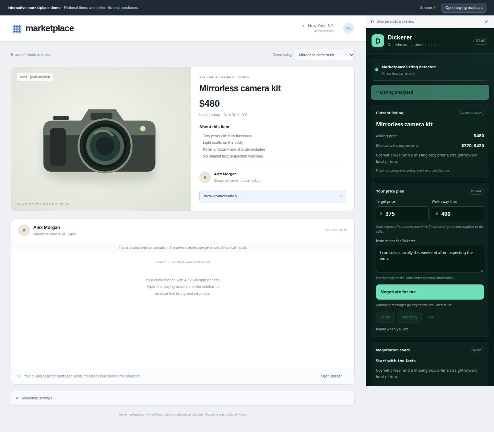

# Dickerer — Marketplace sidebar demo

**[Try the public demo](https://cbring.synology.me/dickerer/)** · [Automated checks](https://github.com/csbring/dickerer-demo/actions)

A fictional marketplace with Dickerer in a separate browser sidebar. The main page contains the listing and the buyer’s conversation with a simulated seller. Only the sidebar contains Dickerer’s listing analysis, private price plan, instructions, negotiation controls and advice. Both negotiation roles generate live responses through local Ollama.

The public link includes an embedded sidebar preview. The same sidebar UI is packaged as a real Manifest V3 Chrome/Edge side-panel extension, scoped only to the demo marketplace. Opening the installed extension hides the embedded preview, leaving the marketplace page and the native browser sidebar.

**Status:** working simulation demo. The broader Dickerer marketplace buying copilot is incomplete. This demo does not contact real sellers, send marketplace messages, make purchases, or establish real-world savings.



## Install the demo extension

1. [Download the demo extension](https://cbring.synology.me/dickerer/static/dickerer-sidebar.zip) and unzip it.
2. In Chrome or Edge, open the extensions page and enable **Developer mode**.
3. Choose **Load unpacked** and select the unzipped folder containing `manifest.json`.
4. Open the [demo marketplace](https://cbring.synology.me/dickerer/) and click the extension’s toolbar icon.
5. In Dickerer’s sidebar, choose **Analyze this listing**, set your limits, then choose **Negotiate for me**. Buyer and seller messages appear on the marketplace page.

This is a real browser side panel, but it is a demo-specific extension—not a release of the unfinished Facebook/Craigslist product. It does not read other websites or connect to marketplace accounts. The hosted preview also works without installation, including on mobile.

## Run locally

Requires Python 3.11+, Ollama, and `qwen3.5:27b` (or a compatible model supporting structured output). The hosted demo runs on the author's local GPU. Model size affects hardware requirements and response time.

```bash
python3 -m venv .venv
source .venv/bin/activate
pip install -e '.[test]'
ollama pull qwen3.5:27b
python -m dickerer_demo.app
```

Open `http://127.0.0.1:8770`. Use `OLLAMA_MODEL` and `OLLAMA_URL` to configure your own local inference server. No cloud fallback or fake conversation is substituted when a model fails.

## What the demo demonstrates

- Separate role contexts: the seller does not receive the buyer's budget, target, private brief or decision explanations. The buyer never receives the seller's floor.
- Deterministic price checks reject over-budget offers, below-floor seller prices, invalid acceptances and contradictory price movements. These checks are adapted from the budget-first approach in the original Dickerer copilot.
- Actual local generation for both roles, with one bounded retry for malformed or invalid replies.
- Automatic play, pause, single-message stepping, ending, refresh recovery and transcript download.
- Genuine no-deal outcomes: a firm seller may be incompatible with the buyer's budget.
- Mobile and desktop layouts, keyboard controls, reduced-motion support and accessible status messages.

The price and action fields are authoritative. Matching price mentions in model prose are replaced with “this price”; conflicting numeric or dollar-word amounts are rejected. Model wording can still be imperfect. The same model plays two separate roles; these are not independent trained systems. Comparables, condition details, seller personas and price floors are invented scenario inputs, not scraped market data. Decision explanations are short model-written summaries, not an exposure of hidden reasoning.

## Public hosting architecture

Synology serves the static interface and a narrow PHP API gateway. The workstation runs the FastAPI service and local Ollama. The inference service is not directly exposed to the internet. The gateway forwards only allowlisted demo routes and authenticates to the backend with a server-side key. See [deployment instructions](deploy/README.md).

Visitor sessions use high-entropy bearer tokens, separate authorization checks, and SQLite persistence. A session lasts 24 hours and is deleted when the visitor resets it. No account login is required. Do not enter personal details: the host stores the fictional brief and conversation until deletion/expiry cleanup. Expired rows are removed on startup and new-session creation. No analytics, external fonts, model API credentials or datasets are bundled.

Public inference is bounded: one generation at a time, at most three queued/in-flight sessions, 12 messages per session, 20 turn attempts per session, 80 turns/hour per IP, and 300 turns/hour globally. Each turn can use at most two model requests. One backend process owns the queue; run exactly one worker. The host must remain online, and model speed depends on its hardware and other load.

## Configuration

| Variable | Default |
|---|---|
| `OLLAMA_URL` | `http://127.0.0.1:11434` |
| `OLLAMA_MODEL` | `qwen3.5:27b` |
| `DICKERER_BIND` | `127.0.0.1` |
| `DICKERER_PORT` | `8770` |
| `DICKERER_DATA_DIR` | `~/.local/share/dickerer-demo` |
| `DICKERER_GATEWAY_KEY` | unset; required for non-loopback binding |

Runtime keys and the session database belong outside the checkout. The published repository contains source code, synthetic tests and fictional scenarios only.

## Extension architecture

`panel.html`, `panel.css` and `panel.js` are shared by the hosted sidebar preview and the installable extension. The page owns the negotiation session and API token. The extension passes only allowlisted commands through a content-script bridge on `/dickerer/`; snapshots contain no bearer token or gateway key. When the active tab is unsupported, the sidebar hides the previous listing and disables actions. No remote executable code is loaded by the extension.

The **Analyze this listing** step reads fictional scenario details and their predefined comparison range. It is not a separate model appraisal or live-market lookup. Negotiation replies and decision summaries are generated by the local model.

Build the downloadable six-file extension with:

```bash
python scripts/build_extension.py
```

The unpacked folder is `dist/dickerer-sidebar/`; the ZIP is `dickerer_demo/static/dickerer-sidebar.zip`. Both are ignored build artifacts.

## Verification

```bash
pytest -q
```

Tests use an isolated database and a fake model adapter to exercise negotiation invariants, isolation, authorization, duplicate requests, pause/end behavior, persistence and failure recovery. The public app always uses Ollama; test doubles are not exposed as a runtime mode. An explicit live smoke script exercises both agents against your own local Ollama without contacting a seller.

The original Dickerer app remains separate. This repository is the focused demo, not a claim that its extension, marketplace integrations or full product are finished.

See [verification notes](docs/VALIDATION.md) for the tested scope and limitations.
